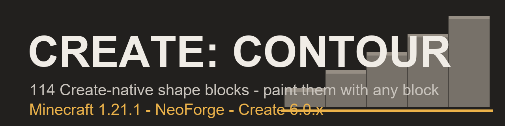

# Create: Contour

A Create addon for NeoForge 1.21.1 that gives builders **114 Create-native
shape blocks** which copy the material of any block you paint them with -
slabs, stairs, panels, slopes, doors, catwalks and many more - so trains,
contraptions and builds can take any shape in any material.

- **Any block, any shape** - paint a Contour form with a neighboring block's
  material; the shape renders, collides and stacks in that material.
- **Contour Placer** - a tool that places blank shapes as ammunition:
  configure the target shape on its rear display, left-click to place,
  right-click to swoop a placed shape back into blank ammo and refund its
  material.
- **Contour Codex** - an in-world guide documenting every shape and gesture.
- **Real builder QoL** - wrench orientation cycling, snow-style stacking for
  layers/half-layers/slices, waterlogging, paint-mismatch merge rules, and
  paired doors (normal, iron/redstone-only, sliding, folding).
- **Create-integrated** - contraption and train friendly; Create schematics
  list required materials and paid material credit survives
  serialize/deserialize.

## Requirements

- Minecraft **1.21.1** - NeoForge **21.1.x** - Java **21**
- [Create](https://github.com/Creators-of-Create/Create) **6.0.x** (bundles
  Flywheel + Ponder)

## Install

1. Grab `create_contour-<version>.jar` from
   [Releases](https://github.com/DurdeuVlad/create-contour/releases) and
   verify the `.sha256` against the checksums attached there.
2. Drop it into `mods/` alongside Create.

## In-game quick start

1. Craft blank **Contour** shape items (manual + Create mechanical-crafting
   recipes for every form).
2. Place a shape, then apply any full-cube block to paint it with that
   material.
3. Wrench cycles orientation; layers/slices stack on same-material re-click;
   breaking returns the blank shape **plus** the material used.

## Evidence

- `runGameTestServer`: **144/144** required tests pass
  (`.cache` QA logs recorded in `docs/Testing.md`).
- `runClientQA` render smoke: **318,503 checks / 0 failed** across the full
  114-shape catalog and material matrix.
- 286-mod Rustic-Craft-2-class pack: dedicated server `Done` boot and client
  world join both pass with the release jar.

Not yet exercised end-to-end: multiplayer two-client sync, train
contraption journeys, in-client Ponder playback, and a real schematicannon
run - tracked in `docs/Testing.md` (marked `NOT RUN`, not claimed).

## Roadmap

All geometrically boundable shapes ship in `0.2.0-alpha`. Remaining
documented families: true multipart plates (multiple painted occupants per
cell, ADR-016) and kinetic/fluid disguises - see
[docs/issues/13-deferred-families.md](docs/issues/13-deferred-families.md).

## Project docs

- `docs/Business.md` / `docs/Decision.md` - product contract and ADRs
- `docs/Architecture.md` / `docs/Testing.md` - internals and evidence model
- `docs/Continuation.md` - edge-profile vocabulary + per-family mate tables (ADR-017)
- `docs/issues/` - per-issue contracts with acceptance criteria
- `docs/publishing/curseforge-page.md` - CurseForge publishing package

## Contributing & license

Contributions welcome - see [CONTRIBUTING.md](CONTRIBUTING.md) (note the
clean-room rule: no code or assets may be taken from competitor mods).
Security reports: [SECURITY.md](SECURITY.md).

Licensed **MIT** ([LICENSE](LICENSE)), copyright (c) 2026 DurdeuVlad and
Create: Contour contributors. Built on
[Create](https://github.com/Creators-of-Create/Create) by the Create team:
Create's code is MIT-licensed; Create's art assets are All Rights Reserved
and are **not** reused here - all Contour textures and models are original.
Not affiliated with, endorsed by, or sponsored by the Create team, CurseForge
or Modrinth.
